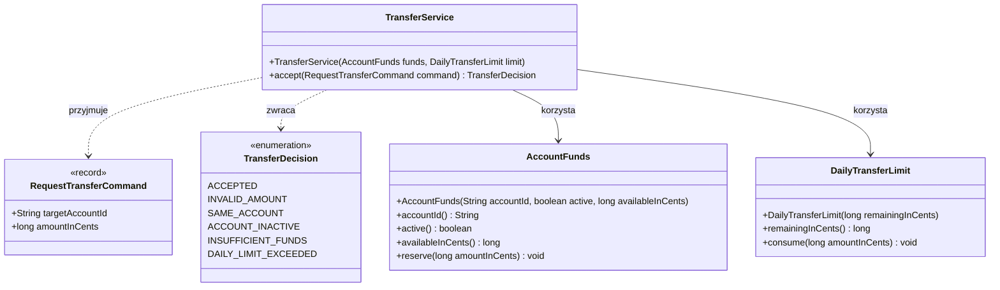

# 🏦 Bank od środka
## Laboratorium 1 · Subdomena Przelewy

> **Rozmowa → reguły → diagram → testy → implementacja.**  
> Dzisiaj implementujesz przyjmowanie dyspozycji przelewu. Podział aplikacji na subdomeny jest już ustalony.

**Narzędzia:** Java 17 lub nowsza, Maven, JUnit 5, IDE.

Materiał towarzyszy wykładowi [DDD: odkrywanie domeny](https://pjmpr.github.io/MPR-lectures/lectures/04-ddd-domain-discovery.html). Na kolejnych laboratoriach zajmiemy się następnymi subdomenami tego samego banku.

> [!IMPORTANT]
> Reguły dotyczą fikcyjnego banku edukacyjnego. Przyjęcie dyspozycji nie oznacza jeszcze wykonania przelewu ani rozliczenia między rachunkami.

**Oznaczenia:** 📖 definicja · 💬 rozmowa · ✍️ zadanie · ✅ rezultat · 🧪 sprawdzenie.

---

## 1. 🧩 Gotowy podział aplikacji

### 📖 Definicje

**Domena** to obszar działalności, którego problemy rozwiązujemy. Tutaj jest nim bankowość internetowa.

**Subdomena** to część domeny mająca własne cele, wiedzę i reguły biznesowe. W tym laboratorium podział jest dostarczony — nie musisz go samodzielnie odkrywać ani proponować alternatyw.

| Subdomena | Odpowiedzialność | Zakres dzisiaj |
|---|---|---|
| Dostęp do bankowości | Logowanie i dostęp klienta do aplikacji | Temat kolejnych zajęć |
| Rachunki i środki | Prowadzenie rachunków, dostępne środki i rezerwacje | Temat kolejnych zajęć |
| **Przelewy** | **Przyjmowanie dyspozycji i reguły ich obsługi** | **Diagram, testy i implementacja** |
| Odbiorcy | Książka odbiorców i oznaczenie zaufania | Temat kolejnych zajęć |
| Powiadomienia | Dostarczanie informacji klientowi | Temat kolejnych zajęć |

> [!NOTE]
> Skupiamy się wyłącznie na **Przelewach**. Pozostałe subdomeny są kontekstem dla dalszych zajęć. Nie implementuj dzisiaj logowania, książki odbiorców, wysyłania wiadomości ani kompletnego prowadzenia rachunków.

✅ **Rezultat:** wiesz, gdzie umieścić dzisiejszy kod i jakie odpowiedzialności pozostają poza jego zakresem.

---

## 2. 🛠️ Przygotuj jeden projekt Java Maven

### 📖 Definicja

**Projekt Maven** opisuje budowanie kodu, jego zależności i sposób uruchamiania testów w pliku `pom.xml`. Dzisiaj tworzymy jeden prosty projekt dla subdomeny Przelewy.

### ✍️ Zadanie 1

Utwórz projekt `transfers` z jednym plikiem `pom.xml`. Kod produkcyjny umieść w `src/main/java`, a testy w `src/test/java`. Używamy pakietu `pl.edu.banklab.transfers`.

**`pom.xml`:**

```xml
<project xmlns="http://maven.apache.org/POM/4.0.0"
         xmlns:xsi="http://www.w3.org/2001/XMLSchema-instance"
         xsi:schemaLocation="http://maven.apache.org/POM/4.0.0 https://maven.apache.org/xsd/maven-4.0.0.xsd">
    <modelVersion>4.0.0</modelVersion>
    <groupId>pl.edu.banklab</groupId>
    <artifactId>transfers</artifactId>
    <version>1.0-SNAPSHOT</version>
    <properties>
        <maven.compiler.release>17</maven.compiler.release>
        <project.build.sourceEncoding>UTF-8</project.build.sourceEncoding>
    </properties>
    <dependencies>
        <dependency>
            <groupId>org.junit.jupiter</groupId>
            <artifactId>junit-jupiter</artifactId>
            <version>5.10.3</version>
            <scope>test</scope>
        </dependency>
    </dependencies>
    <build>
        <plugins>
            <plugin>
                <groupId>org.apache.maven.plugins</groupId>
                <artifactId>maven-compiler-plugin</artifactId>
                <version>3.13.0</version>
            </plugin>
            <plugin>
                <groupId>org.apache.maven.plugins</groupId>
                <artifactId>maven-surefire-plugin</artifactId>
                <version>3.2.5</version>
            </plugin>
        </plugins>
    </build>
</project>
```

> [!NOTE]
> Pozostałe subdomeny pozostają na razie opisem obszarów banku. Ich kod oraz ewentualny podział projektu dodamy w kolejnych dokumentach. Dzisiejszy przykład działa lokalnie, bez Springa, bazy danych i REST.

✅ **Rezultat:** w katalogu zawierającym `pom.xml` polecenie `mvn test` kończy się poprawnie — na razie bez testów.

---

## 3. 📐 Od rozmowy do modelu przelewu

### 📖 Definicje

**Ubiquitous Language — wspólny język** to uzgodnione pojęcia używane w rozmowie, dokumentacji, testach i kodzie. Dla tego ćwiczenia kluczowe są „dyspozycja”, „przyjęcie”, „dostępne środki” i „pozostały limit”.

**Model domenowy** to celowe uproszczenie wiedzy potrzebnej do rozwiązania konkretnego problemu. Nie musi odwzorowywać całego banku.

**Komenda** wyraża intencję wykonania działania. **Zdarzenie domenowe** opisuje istotny fakt, który już nastąpił. **Reguła biznesowa** określa warunek lub konsekwencję działania.

**Diagram klas** przedstawia typy, ich odpowiedzialności i powiązania. Na tych zajęciach pomaga odczytać kontrakt kodu; nie wprowadzamy jeszcze pełnego modelu agregatów i repozytoriów.

### 💬 Rozmowa projektanta z ekspertem · Przyjęcie dyspozycji

> 🧑‍💻 **Projektant:** Co dokładnie przyjmujemy dzisiaj?
>
> 🧑‍💼 **Ekspert:** Dyspozycję przelewu w EUR, z rachunku aktywnego klienta na inny rachunek. Kwota musi być większa od zera.
>
> 🧑‍💻 **Projektant:** Czy przyjęcie dyspozycji oznacza, że pieniądze dotarły już do odbiorcy?
>
> 🧑‍💼 **Ekspert:** Nie. Potwierdzamy przyjęcie polecenia. Rozliczenie nastąpi później; dzisiaj go nie modelujemy.
>
> 🧑‍💻 **Projektant:** Skąd wiemy, czy są środki?
>
> 🧑‍💼 **Ekspert:** Dostajemy aktualną informację z obszaru rachunków. Chodzi o dostępne środki, nie samo saldo księgowe. Przy saldzie 1000 EUR i wcześniejszych rezerwacjach 300 EUR dostępne jest 700 EUR. Jeśli kwota przelewu jest równa dostępnym środkom, można go przyjąć. Nie obsługujemy debetu.
>
> 🧑‍💻 **Projektant:** A limit?
>
> 🧑‍💼 **Ekspert:** Dostajemy pozostały limit dzienny. Kwota równa temu limitowi jest dozwolona. Przyjęcie zmniejsza zarówno dostępne środki, jak i pozostały limit o kwotę przelewu.
>
> 🧑‍💻 **Projektant:** Jeżeli przelew narusza kilka zasad, który powód pokazujemy?
>
> 🧑‍💼 **Ekspert:** Kolejno sprawdzamy: kwotę, różne rachunki, aktywność rachunku źródłowego, dostępne środki, limit. Zwracamy pierwszy powód odmowy.
>
> 🧑‍💻 **Projektant:** Czy zmniejszamy środki od razu, przed sprawdzeniem limitu?
>
> 🧑‍💼 **Ekspert:** Nie. Najpierw wszystkie sprawdzenia. Przy odmowie nic się nie zmienia.

### 📋 Kontrakt ćwiczenia

| Kolejność | Warunek odmowy | Wynik |
|---|---|---|
| 1 | Kwota ≤ 0 | `INVALID_AMOUNT` |
| 2 | Rachunek źródłowy jest taki sam jak docelowy | `SAME_ACCOUNT` |
| 3 | Rachunek źródłowy jest nieaktywny | `ACCOUNT_INACTIVE` |
| 4 | Kwota > dostępne środki | `INSUFFICIENT_FUNDS` |
| 5 | Kwota > pozostały limit dzienny | `DAILY_LIMIT_EXCEEDED` |
| — | Wszystkie warunki spełnione | `ACCEPTED` i zmniejszenie obu wartości |

**Założenia wejściowe:** identyfikatory są niepustymi napisami, kwoty są podane w **centach** jako `long` (**100 centów = 1 EUR**), dostępne środki i limit są nieujemne. Nie implementujemy IBAN, kursów walut, opłat, zmiany daty ani współbieżności.

> [!IMPORTANT]
> `AccountFunds` jest lokalnym, uproszczonym modelem informacji potrzebnych przelewom. Na dziś przechowuje środki w pamięci i symuluje ich rezerwowanie. Nie stanowi kompletnej implementacji subdomeny Rachunki. W produkcji sprawdzenie i rezerwacja wymagałyby spójnego mechanizmu odpornego na równoczesne operacje.

### 🗺️ Dostarczony diagram



**Jak odczytać model:** jedna instancja `TransferService` jest powiązana z jednym rachunkiem źródłowym i jego pozostałym limitem. Komenda wskazuje odbiorcę i kwotę. Rachunek docelowy jest identyfikatorem; nie tworzymy jego lokalnego salda.

**Konstruktor serwisu:** `TransferService(AccountFunds funds, DailyTransferLimit limit)`.

### ✅ Odpowiedź · Od rozmowy do kodu

| Element procesu | Odpowiedź |
|---|---|
| Aktor | Klient banku zlecający przelew |
| Komenda | `RequestTransferCommand` — intencja przyjęcia dyspozycji przelewu |
| Fakt pozytywny | `TransferAccepted` — dyspozycja została przyjęta |
| Fakt negatywny | `TransferRejected` — dyspozycja została odrzucona z określonego powodu |

**`TransferAccepted` nie oznacza `TransferExecuted`:** bank zaakceptował dyspozycję i zarezerwował środki, ale rozliczenie oraz przekazanie pieniędzy odbiorcy następują później.

Model obejmuje pięć typów w pakiecie `pl.edu.banklab.transfers`: `TransferService`, `RequestTransferCommand`, `TransferDecision`, `AccountFunds` i `DailyTransferLimit`. Utwórz je zgodnie z diagramem przed uruchomieniem testów. Metoda `accept` może początkowo rzucać `UnsupportedOperationException`.

> [!NOTE]
> W kodzie zwracamy prostą decyzję `TransferDecision`. Nazwy `TransferAccepted` i `TransferRejected` opisują fakty domenowe — nie tworzymy dzisiaj osobnych klas zdarzeń ani mechanizmu ich publikacji.

---

## 4. 🧪 Implementuj zachowanie krok po kroku

### ✍️ Zadanie 2 · Najpierw uruchom czerwony test

Utwórz `src/test/java/pl/edu/banklab/transfers/TransferServiceTest.java` i wklej poniższy kod. Pliki produkcyjne umieść w `src/main/java/pl/edu/banklab/transfers/`.

```java
package pl.edu.banklab.transfers;

import org.junit.jupiter.api.Test;
import org.junit.jupiter.params.ParameterizedTest;
import org.junit.jupiter.params.provider.ValueSource;

import static org.junit.jupiter.api.Assertions.assertAll;
import static org.junit.jupiter.api.Assertions.assertEquals;

class TransferServiceTest {
    private final AccountFunds funds = new AccountFunds("ACC-1", true, 100_000L);
    private final DailyTransferLimit limit = new DailyTransferLimit(60_000L);
    private final TransferService service = new TransferService(funds, limit);

    private RequestTransferCommand transfer(long amount) {
        return new RequestTransferCommand("ACC-2", amount);
    }

    private void assertUnchanged() {
        assertAll(
            () -> assertEquals(100_000L, funds.availableInCents()),
            () -> assertEquals(60_000L, limit.remainingInCents())
        );
    }

    @Test
    void acceptsTransferAndReservesFundsAndLimit() {
        var result = service.accept(transfer(25_000L));
        assertAll(
            () -> assertEquals(TransferDecision.ACCEPTED, result),
            () -> assertEquals(75_000L, funds.availableInCents()),
            () -> assertEquals(35_000L, limit.remainingInCents())
        );
    }

    @ParameterizedTest
    @ValueSource(longs = {0L, -1L, -10_000L})
    void rejectsNonPositiveAmountWithoutChangingState(long amount) {
        assertEquals(TransferDecision.INVALID_AMOUNT, service.accept(transfer(amount)));
        assertUnchanged();
    }

    @Test
    void rejectsTransferToTheSameAccountWithoutChangingState() {
        var command = new RequestTransferCommand("ACC-1", 10_000L);
        assertEquals(TransferDecision.SAME_ACCOUNT, service.accept(command));
        assertUnchanged();
    }

    @Test
    void rejectsInactiveSourceAccountWithoutChangingState() {
        var inactive = new AccountFunds("ACC-1", false, 100_000L);
        var otherService = new TransferService(inactive, limit);
        assertEquals(TransferDecision.ACCOUNT_INACTIVE,
            otherService.accept(transfer(10_000L)));
        assertAll(
            () -> assertEquals(100_000L, inactive.availableInCents()),
            () -> assertEquals(60_000L, limit.remainingInCents())
        );
    }

    @Test
    void rejectsInsufficientFundsBeforeCheckingLimit() {
        // Kwota przekracza jednocześnie środki i limit.
        assertEquals(TransferDecision.INSUFFICIENT_FUNDS,
            service.accept(transfer(100_001L)));
        assertUnchanged();
    }

    @Test
    void rejectsExceededDailyLimitWithoutReservingFunds() {
        assertEquals(TransferDecision.DAILY_LIMIT_EXCEEDED,
            service.accept(transfer(60_001L)));
        assertUnchanged();
    }

    @Test
    void acceptsAmountEqualToRemainingLimit() {
        assertEquals(TransferDecision.ACCEPTED, service.accept(transfer(60_000L)));
        assertAll(
            () -> assertEquals(40_000L, funds.availableInCents()),
            () -> assertEquals(0L, limit.remainingInCents())
        );
    }

    @Test
    void acceptsAmountEqualToAvailableFunds() {
        var smallAccount = new AccountFunds("ACC-1", true, 20_000L);
        var otherService = new TransferService(smallAccount, limit);
        assertEquals(TransferDecision.ACCEPTED,
            otherService.accept(transfer(20_000L)));
        assertAll(
            () -> assertEquals(0L, smallAccount.availableInCents()),
            () -> assertEquals(40_000L, limit.remainingInCents())
        );
    }

    @Test
    void subsequentTransferUsesRemainingLimit() {
        assertEquals(TransferDecision.ACCEPTED, service.accept(transfer(40_000L)));
        assertEquals(TransferDecision.DAILY_LIMIT_EXCEEDED,
            service.accept(transfer(25_000L)));
        assertAll(
            () -> assertEquals(60_000L, funds.availableInCents()),
            () -> assertEquals(20_000L, limit.remainingInCents())
        );
    }

    @Test
    void subsequentTransferUsesRemainingFunds() {
        var smallAccount = new AccountFunds("ACC-1", true, 30_000L);
        var otherService = new TransferService(smallAccount, limit);
        assertEquals(TransferDecision.ACCEPTED,
            otherService.accept(transfer(20_000L)));
        assertEquals(TransferDecision.INSUFFICIENT_FUNDS,
            otherService.accept(transfer(15_000L)));
        assertAll(
            () -> assertEquals(10_000L, smallAccount.availableInCents()),
            () -> assertEquals(40_000L, limit.remainingInCents())
        );
    }

    @Test
    void validatesAmountBeforeAccountIdentity() {
        var command = new RequestTransferCommand("ACC-1", 0L);
        assertEquals(TransferDecision.INVALID_AMOUNT, service.accept(command));
        assertUnchanged();
    }

    @Test
    void validatesAccountIdentityBeforeActivity() {
        var inactive = new AccountFunds("ACC-1", false, 100_000L);
        var otherService = new TransferService(inactive, limit);
        assertEquals(TransferDecision.SAME_ACCOUNT,
            otherService.accept(new RequestTransferCommand("ACC-1", 10_000L)));
        assertEquals(100_000L, inactive.availableInCents());
        assertEquals(60_000L, limit.remainingInCents());
    }

    @Test
    void validatesActivityBeforeFunds() {
        var inactive = new AccountFunds("ACC-1", false, 100_000L);
        var otherService = new TransferService(inactive, limit);
        assertEquals(TransferDecision.ACCOUNT_INACTIVE,
            otherService.accept(transfer(100_001L)));
        assertEquals(100_000L, inactive.availableInCents());
        assertEquals(60_000L, limit.remainingInCents());
    }
}
```

### 🪜 Kolejność pracy

| Etap | Co uruchomić i zaimplementować |
|---|---|
| A | Pierwszy test: przyjęcie oraz zmniejszenie środków i limitu |
| B | Testy niedodatniej kwoty i tego samego rachunku |
| C | Test nieaktywnego rachunku |
| D | Testy braku środków i kwoty równej dostępnym środkom |
| E | Testy przekroczenia limitu i równości z limitem |
| F | Testy kolejnych dyspozycji |
| G | Testy kolejności walidacji i cały zestaw |

Uruchamiaj wybrany test z IDE albo z głównego katalogu:

```shell
mvn -Dtest=TransferServiceTest#acceptsTransferAndReservesFundsAndLimit test
```

Cały zestaw testów projektu:

```shell
mvn test
```

> [!TIP]
> Najpierw sprawdź wszystkie reguły, dopiero potem zmień stan. Nie odejmuj środków przed weryfikacją limitu. Każdy test ma własne obiekty, ale kilka wywołań w jednym teście korzysta z tego samego stanu.

> [!NOTE]
> `AccountFunds.reserve` i `DailyTransferLimit.consume` są operacjami pomocniczymi wykonywanymi po walidacji. Nie dodawaj publicznych setterów. Błędna dyspozycja ma zwracać decyzję odmowy z serwisu, a nie kończyć się wyjątkiem z konstruktora komendy.

✅ **Rezultat:** wszystkie testy przechodzą, nazwy odpowiadają językowi rozmowy, a odmowa nie zmienia stanu. Nie musisz tworzyć metody `main`.

---

## 5. 🔬 Eksperyment · Bank zmienia zasady

### 📋 Nowe wymaganie do samodzielnego eksperymentu

Bank wprowadza dodatkowy **limit pojedynczego przelewu do odbiorcy niezaufanego: 200 EUR**. Dla odbiorców zaufanych ten dodatkowy limit nie obowiązuje. Nadal obowiązują wszystkie wcześniejsze reguły, w tym dostępne środki i limit dzienny.

Nową regułę sprawdzamy **na końcu**. Kwota dokładnie 200 EUR jest dozwolona dla niezaufanego odbiorcy. Informacja o zaufaniu pochodzi z subdomeny Odbiorcy, a nie z formularza dyspozycji. Na dzisiaj zasymulujesz tę informację w teście — nie implementujesz drugiej subdomeny.

### ✍️ Zadanie 3 · Małe rozszerzenie modelu

1. Skopiuj diagram do `docs/transfer-model.md` i rozszerz go o interfejs `TrustedBeneficiaries` z metodą `boolean isTrusted(String targetAccountId)`. Serwis otrzymuje go przez konstruktor. Nie dodawaj pola `trusted` do komendy.
2. Dodaj decyzję `UNTRUSTED_BENEFICIARY_LIMIT_EXCEEDED`.
3. Napisz testy dla niezaufanego odbiorcy: **200 EUR — przyjęcie**, **200,01 EUR — odmowa bez zmiany stanu**.
4. Napisz test przyjęcia **200,01 EUR** dla zaufanego odbiorcy i test potwierdzający, że nadal obowiązuje go limit dzienny.
5. Zaimplementuj regułę. W testach użyj lambdy lub prostej implementacji interfejsu w pamięci.

> [!WARNING]
> Nowa reguła celowo zmienia warunki wcześniejszych testów. Ustaw w ich konfiguracji odbiorcę jako zaufanego, aby nadal sprawdzały pierwotne reguły. Zachowaj wcześniejsze asercje. Dodatkowy test powinien pokazać, że przy przekroczeniu obu limitów pierwszeństwo ma `DAILY_LIMIT_EXCEEDED`.

**Do dyskusji:** dlaczego interfejs potrzebny przelewom znajduje się w projekcie przelewów, choć wiedza o zaufaniu pochodzi z innej subdomeny? W przyszłości kod subdomeny Odbiorcy może dostarczyć implementację tego kontraktu.

✅ **Rezultat:** zmieniony diagram, nowe testy i rozszerzona logika.

> [!TIP]
> Najpierw ukończ część podstawową. Eksperyment ma zająć ostatnie minuty zajęć; jeśli zabraknie czasu, dokończ go samodzielnie. Nie rozbudowuj dzisiaj książki odbiorców.
