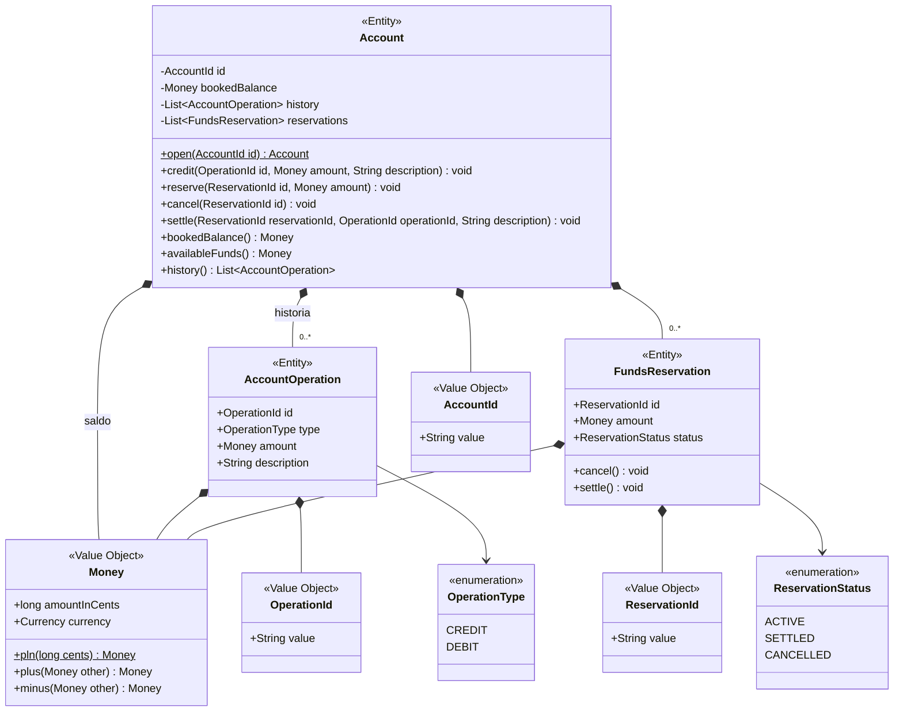

# Bank od środka

## Laboratorium 2 · Rachunki i środki: Entity oraz Value Object

> **Rozmowa → decyzje modelowe → diagram → odblokowywanie testów → implementacja.**  
> Tym razem modelujesz rachunek, jego środki, rezerwacje oraz historię zaksięgowanych operacji.

**Narzędzia:** Java 17+, Maven, JUnit 5, IDE.  
**Pakiet:** `pl.edu.banklab.accounts`.

Materiał towarzyszy wykładowi [DDD: taktyczne building blocks](https://pjmpr.github.io/MPR-lectures/lectures/05-ddd-building-blocks.html). Ćwiczenie skupia się na encjach, Value Objects, zachowaniu i niezmiennikach. Nie projektujemy jeszcze repozytoriów, bazy danych ani pełnych granic agregatów.

> [!IMPORTANT]
> Dostarczone klasy są szkieletem, a wszystkie testy mają początkowo adnotację `@Disabled` z opisem sprawdzanego zachowania. Odblokowuj po jednym teście, doprowadzaj go do zielonego stanu i dopiero wtedy przechodź do następnego. To zamierzony tok TDD, a nie wyjątkowo spokojny dzień w banku.

---

## 1. Cel zajęć

Po wykonaniu zadania potrafisz:

- rozpoznać obiekt wymagający tożsamości i cyklu życia;
- zaprojektować niemutowalny Value Object, który nie dopuszcza błędnej wartości;
- odróżnić równość encji od równości wartości;
- umieścić reguły zmiany salda w modelu, zamiast w klasie `AccountService`;
- zachować historię tego samego rachunku mimo zmian jego stanu;
- przełożyć przykłady z rozmowy na testy jednostkowe.

## 2. Czy historia operacji jest osobną subdomeną?

Historia zaksięgowanych uznań i obciążeń jest częścią języka oraz cyklu życia rachunku. Bez niej trudno odpowiedzieć, dlaczego saldo ma daną wartość. `AccountOperation` należy więc do subdomeny **Rachunki i środki**.

Granica może się zmienić. Osobny kontekst byłby uzasadniony, gdyby pojawiły się niezależne potrzeby: wieloletnie archiwum, raporty regulacyjne, wyszukiwanie operacji ze wszystkich produktów, generowanie wyciągów czy inny model retencji. Dzisiaj tego nie potrzebujemy. Model jest hipotezą, nie umową podpisaną z przyszłością.

Rozróżniamy:

| W zakresie | Poza zakresem |
|---|---|
| Historia zaksięgowanych uznań i obciążeń jednego rachunku | Logi techniczne i audyt bezpieczeństwa |
| Powiązanie operacji z rachunkiem | Raporty przekrojowe między klientami |
| Kolejność operacji w pamięci | Wyciągi PDF, filtrowanie i paginacja |
| Rezerwowanie, anulowanie i rozliczanie środków | Trwałość, współbieżność i integracja z księgą główną |

---

## 3. Rozmowa projektanta z ekspertem · „Saldo to przecież jedna liczba”

*Projektant przynosi diagram z jedną klasą i czternastoma setterami. Ekspert przynosi kawę. Tylko jedno z nich przetrwa spotkanie bez zmian.*

> **Projektant:** Rachunek ma `String id` i `long balance`. Dwa pola, jeden setter, kwadrans pracy.
>
> **Ekspert:** Ten sam rachunek może mieć dziś sto złotych, jutro tysiąc, a w piątek smutne trzy złote. Nadal jest tym samym rachunkiem.
>
> **Projektant:** Czyli `equals` po wszystkich polach odpada, bo po wypłacie rachunek przestanie być równy samemu sobie. Brzmi jak kryzys tożsamości.
>
> **Ekspert:** Tożsamość daje `AccountId`. Saldo opisuje stan, nie tożsamość.
>
> **Projektant:** To może wszędzie `long` w groszach? Minus pięć złotych też się zmieści.
>
> **Ekspert:** `Money` ma walutę i nieujemną kwotę. Dwie kwoty są równe, gdy mają tę samą liczbę groszy i walutę. Nie mają osobnej historii ani numeru seryjnego.
>
> **Projektant:** Czyli `Money` to Value Object: niemutowalny, równy po wartości i poprawny od chwili utworzenia.
>
> **Ekspert:** Tak. I nie dodawaj metody `setAmount`, chyba że chcesz, aby sto złotych po cichu uznało się za dwieście.
>
> **Projektant:** Klient płaci 80 PLN. Odejmuję od salda?
>
> **Ekspert:** Najpierw rezerwujesz środki. Saldo księgowe się nie zmienia, ale dostępne środki maleją. Potem rezerwację można rozliczyć albo anulować.
>
> **Projektant:** Czy rezerwacja „50 PLN” jest po prostu wartością?
>
> **Ekspert:** Nie. Rezerwację rozpoznajemy po `ReservationId`, śledzimy jej cykl życia i możemy ją rozliczyć tylko raz. Dwie rezerwacje tej samej kwoty nie są tą samą rezerwacją.
>
> **Projektant:** A przy rozliczeniu tworzę obciążenie w historii?
>
> **Ekspert:** Tak. Operacja ma własne `OperationId`, rodzaj, kwotę i opis. Dwa zakupy po 20 PLN to nadal dwie operacje.
>
> **Projektant:** Uznanie działa podobnie, tylko pieniądze idą w przyjemniejszą stronę?
>
> **Ekspert:** Uznanie od razu zwiększa saldo i dostępne środki oraz trafia do historii. Kwota musi być dodatnia.
>
> **Projektant:** A wypłata bez wcześniejszej rezerwacji?
>
> **Ekspert:** W tym modelu jej nie ma. Najpierw rezerwacja, potem rozliczenie. Dzięki temu kod mówi językiem procesu, a nie językiem odejmowania.
>
> **Projektant:** Mogę zarezerwować więcej niż dostępne środki i liczyć na piątkowy przelew?
>
> **Ekspert:** Bank może liczyć odsetki, ale model nie liczy na cuda. Taką próbę odrzucamy bez zmiany stanu.
>
> **Projektant:** A jeśli dwa razy wyślę to samo `OperationId`?
>
> **Ekspert:** Odrzucamy duplikat. Historia nie może dwa razy opowiadać tego samego faktu tylko dlatego, że sieć dostała czkawki.
>
> **Projektant:** To może wystawić `List<AccountOperation>` i pozwolić aplikacji dopisywać?
>
> **Ekspert:** Nie. Rachunek sam chroni historię. Z zewnątrz dostajesz widok tylko do odczytu.
>
> **Projektant:** Rozumiem. Usuwam setter salda.
>
> **Ekspert:** Zapiszmy datę. To ważny moment w historii projektu.

### Kontrakt ćwiczenia

1. `Account` jest encją, a jego równość zależy wyłącznie od `AccountId`.
2. `FundsReservation` jest encją identyfikowaną przez `ReservationId`; ma stan `ACTIVE`, `SETTLED` albo `CANCELLED`.
3. `Money` i identyfikatory są niemutowalnymi Value Objects.
4. Obsługujemy wyłącznie `PLN`. Kwoty przechowujemy w groszach jako `long`.
5. `Money` nie może być ujemne; operacje `credit` i `reserve` wymagają kwoty dodatniej.
6. Uznanie zwiększa saldo księgowe i dostępne środki oraz dopisuje `CREDIT` do historii.
7. Rezerwacja zmniejsza tylko dostępne środki. Nie trafia do historii zaksięgowanych operacji.
8. Anulowanie aktywnej rezerwacji przywraca dostępne środki.
9. Rozliczenie aktywnej rezerwacji zmniejsza saldo księgowe, nie zmienia ponownie środków dostępnych i dopisuje `DEBIT` do historii.
10. Nie można anulować ani rozliczyć tej samej rezerwacji ponownie.
11. Nie można powtórzyć `OperationId` ani `ReservationId` na tym samym rachunku.
12. Odrzucona operacja nie zmienia salda, rezerwacji ani historii.

---

## 4. Decyzje modelowe

| Typ | Building block | Dlaczego |
|---|---|---|
| `Account` | Entity | Zachowuje tożsamość podczas zmian salda i historii |
| `FundsReservation` | Entity | Ma własne ID i cykl życia |
| `AccountOperation` | Entity | Dwa identyczne kwotowo zapisy mogą oznaczać dwa różne fakty |
| `AccountId`, `OperationId`, `ReservationId` | Value Object | Nadają znaczenie identyfikatorom i są równe po wartości |
| `Money` | Value Object | Jest niemutowalne, waliduje kwotę i ma równość strukturalną |
| `OperationType`, `ReservationStatus` | Enum | Zamknięte zbiory nazw domenowych |

> [!NOTE]
> Nie tworzymy `AccountService`, repozytorium ani zdarzeń domenowych tylko po to, by diagram wyglądał poważniej. Zachowanie, które zmienia stan jednego rachunku i broni jego reguł, należy dziś do `Account`.

## 5. Diagram klas



Diagram jest hipotezą do sprawdzenia testami. Nie wyznacza tabel bazy danych.

---

## 6. Praca z testami

Kod produkcyjny znajduje się w `src/main/java`, a testy w `src/test/java`. Najpierw uruchom:

```shell
cd bank-app
mvn -pl bank-app-accounts-logic test
```

Zobaczysz zielony build z pominiętymi testami. Adnotacje `@Disabled` zawierają numery etapów. Odblokowuj testy w tej kolejności: najpierw etapy 1–4 z `MoneyTest`, a następnie etapy 5–12 z `AccountTest`. Usuń adnotację wyłącznie z bieżącego testu i doprowadź go do zielonego stanu przed przejściem dalej.

1. Walidacja oraz równość `Money`.
2. Niemutowalna arytmetyka pieniężna i jej przypadki błędne.
3. Równość `Account` po `AccountId`.
4. Uznanie rachunku i historia operacji.
5. Rezerwacja oraz obliczanie dostępnych środków.
6. Odmowa rezerwacji bez skutków ubocznych.
7. Anulowanie, a następnie rozliczanie rezerwacji.
8. Odrzucanie duplikatów i niedozwolonych przejść stanu.
9. Ochrona kolekcji przed zmianą z zewnątrz.

Nie zmieniaj testów tylko po to, by zrobiły się zielone. Możesz dodawać testy brzegowe, szczególnie dla zera, duplikatów i cyklu życia rezerwacji.

### Kryteria ukończenia

- `mvn -pl bank-app-accounts-logic test` kończy się sukcesem;
- nie ma publicznego settera salda ani modyfikowalnej historii;
- wyjątki mają komunikaty w języku domeny;
- kod nie używa `double` do pieniędzy;
- nazwy metod opisują intencje (`reserve`, `settle`, `cancel`), nie techniczną mutację;
- `Account` zachowuje ID po każdej zmianie stanu.

---
