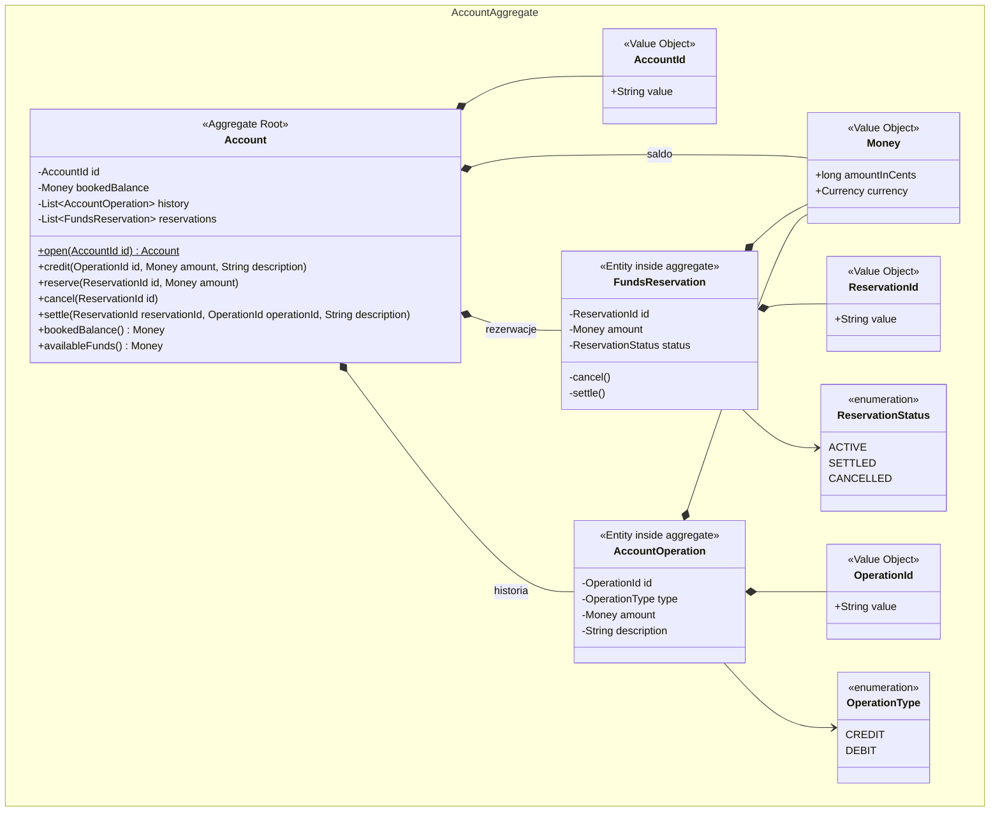
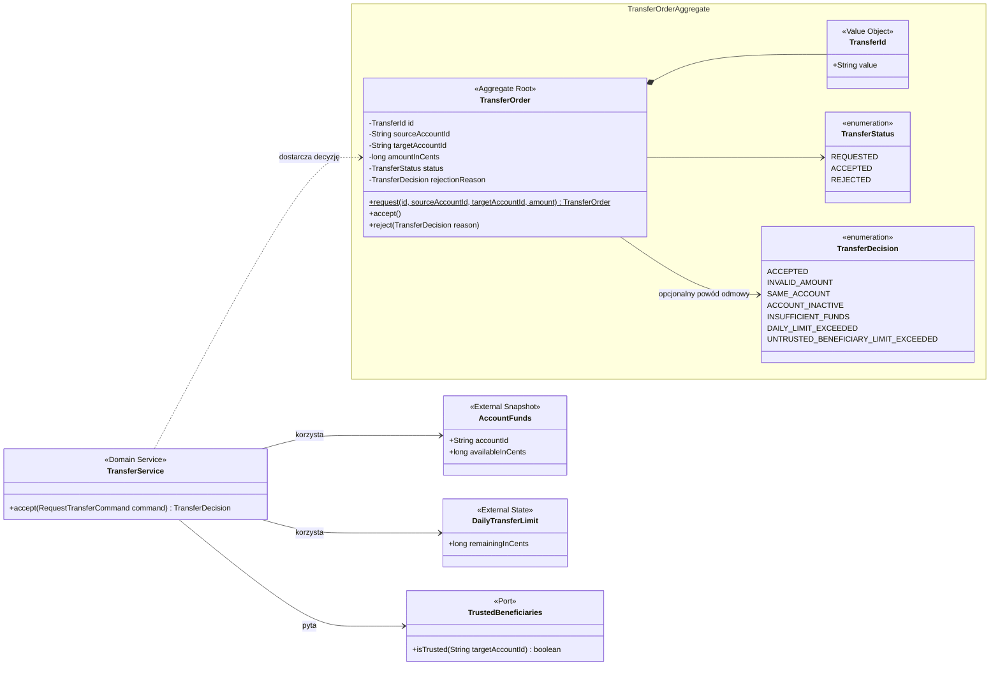

# 🏦 Bank od środka

## 🎓 Laboratorium 3 · Agregaty i Aggregate Root

> **Niezmienniki → granica spójności → Aggregate Root → testy → implementacja.**  
> Tym razem nie dodajesz kolejnej funkcji banku. Porządkujesz granice istniejącego modelu tak, aby reguł biznesowych nie dało się ominąć.

**Narzędzia:** Java 17+, Maven, JUnit 5, Hamcrest, Mockito, IDE.  
**Moduły:** `bank-app-accounts-logic` oraz `bank-app-transfer-logic`.

Materiał towarzyszy wykładowi [DDD: agregaty i granice spójności](https://pjmpr.github.io/MPR-lectures/lectures/06-ddd-aggregates.html).

> 🔑 **Kluczowa zasada**  
> W tym laboratorium **agregat** oznacza granicę spójności, a nie dowolny graf powiązanych klas. **Aggregate Root** jest jedyną bramą prowadzącą do zmiany stanu wewnątrz tej granicy.

**Oznaczenia:** 📖 definicja · 💬 rozmowa · 📐 model · 🛠️ zadanie · 🧪 test · ✅ rezultat

---

## 1. 🎯 Cel zajęć

Po wykonaniu zadania potrafisz:

- wskazać niezmienniki wymagające natychmiastowej ochrony;
- odróżnić encję, serwis domenowy i Aggregate Root;
- ukryć możliwość zmiany encji wewnętrznej z pominięciem root;
- zaprojektować mały agregat na podstawie jego cyklu życia;
- odwoływać się do innych agregatów przez identyfikatory;
- wyjaśnić, dlaczego jedna komenda powinna zmieniać jeden agregat;
- traktować testy jako specyfikację granicy spójności.

## 2. 🧭 Stan początkowy

Repozytorium zawiera dwa działające moduły:

| Moduł | Co już działa | Problem do odkrycia |
|---|---|---|
| Rachunki i środki | Saldo, historia, rezerwowanie, anulowanie i rozliczanie środków | `Account` pilnuje reguł, ale obiekt wewnętrzny nadal udostępnia publiczne operacje zmiany stanu |
| Przelewy | Walidacja dyspozycji, dostępnych środków, limitu dziennego i zaufanego odbiorcy | `TransferService` jest serwisem, lecz nie reprezentuje dyspozycji mającej tożsamość i cykl życia |

Aktualne testy opisują wcześniejsze reguły i muszą nadal przechodzić. Nowe testy agregatów są początkowo oznaczone `@Disabled`. Odblokowuj je pojedynczo.

---

## 3. 💬 Rozmowa projektanta z ekspertem · „Przecież lista jest niemodyfikowalna”

*Projektant pokazuje zielone testy. Ekspert pyta, którędy można zmienić stan. Zielony pasek zaczyna wyglądać mniej uspokajająco.*

> **Projektant:** `Account` ma prywatną listę rezerwacji i zwraca `List.copyOf`. Agregat zamknięty, możemy iść na kawę.
>
> **Ekspert:** Lista jest zamknięta. A obiekty znajdujące się na liście?
>
> **Projektant:** `FundsReservation` ma `cancel()` i `settle()`. To wygodne API.
>
> **Ekspert:** Tak wygodne, że kod zewnętrzny może pobrać rezerwację i anulować ją bez pytania rachunku.
>
> **Projektant:** Ale sama rezerwacja pilnuje, żeby przejście stanu było poprawne.
>
> **Ekspert:** Pilnuje swojego lokalnego stanu. Nie widzi salda, historii ani pozostałych rezerwacji. Kto ma zagwarantować spójność całego rachunku?
>
> **Projektant:** `Account`. Czyli `Account` jest Aggregate Rootem, a rezerwacja encją wewnętrzną.
>
> **Ekspert:** Właśnie. Root nie jest etykietą na diagramie. Musi być jedyną publiczną drogą zmiany wnętrza agregatu.
>
> **Projektant:** Dobrze. To nazwę `TransferService` Aggregate Rootem i problem przelewów też rozwiązany.
>
> **Ekspert:** Jaki ma identyfikator?
>
> **Projektant:** Nie ma.
>
> **Ekspert:** Jaki ma cykl życia?
>
> **Projektant:** Też nie ma. Przyjmuje komendę, sprawdza reguły i zwraca decyzję.
>
> **Ekspert:** Czyli jest serwisem domenowym. Nazwa `Service` tym razem nawet nie kłamie.
>
> **Projektant:** Potrzebujemy więc obiektu reprezentującego konkretną dyspozycję przelewu.
>
> **Ekspert:** Tak. Dyspozycja ma własne ID, rachunek źródłowy, rachunek docelowy, kwotę i stan. Może oczekiwać na decyzję, zostać przyjęta albo odrzucona.
>
> **Projektant:** Włożę do niej cały `Account`, limit dzienny i książkę odbiorców. Będzie jeden potężny agregat banku.
>
> **Ekspert:** I jedna potężna blokada. Rachunek, dyspozycja i odbiorcy mają osobne cykle życia. Przelew przechowuje ich identyfikatory, nie całe obiekty.
>
> **Projektant:** A skąd `TransferOrder` dowie się, że klient ma środki?
>
> **Ekspert:** To reguła wymagająca wiedzy spoza agregatu dyspozycji. Obecny `TransferService` nadal może wyliczyć decyzję. Root pilnuje natomiast własnego cyklu życia: poprawnej komendy i jednokrotnego zapisania decyzji.
>
> **Projektant:** Czyli nie każdy warunek używany podczas operacji automatycznie powiększa agregat.
>
> **Ekspert:** Dokładnie. Granicę wyznaczają reguły, które muszą być chronione razem — nie liczba klas, które potrafimy połączyć strzałką.

---

## 4. 📜 Kontrakt ćwiczenia

### 💳 Agregat Rachunek

1. `Account` jest Aggregate Rootem identyfikowanym przez `AccountId`.
2. `FundsReservation` i `AccountOperation` należą do wnętrza agregatu rachunku.
3. Kod zewnętrzny zmienia rezerwację wyłącznie przez `Account.cancel(...)` lub `Account.settle(...)`.
4. Publiczne API nie pozwala tworzyć encji wewnętrznych jako samodzielnych obiektów domenowych.
5. Odczyt historii i rezerwacji nie umożliwia zmiany kolekcji ani stanu agregatu.
6. Odrzucona operacja pozostawia saldo, rezerwacje i historię bez zmian.

### 🔁 Agregat Dyspozycja przelewu

1. `TransferOrder` jest Aggregate Rootem identyfikowanym przez `TransferId`.
2. Nowa dyspozycja ma stan `REQUESTED`.
3. Identyfikator dyspozycji oraz identyfikatory rachunków są wymagane i nie mogą być puste.
4. Przechowuje wyłącznie identyfikatory rachunków, a nie obiekty `Account`, `AccountFunds`, `DailyTransferLimit` ani `TrustedBeneficiaries`.
5. Kwota musi być dodatnia, a rachunki źródłowy i docelowy muszą być różne.
6. Oczekującą dyspozycję można rozstrzygnąć dokładnie raz: przyjąć albo odrzucić.
7. Przyjęta dyspozycja ma stan `ACCEPTED` i nie ma powodu odmowy.
8. Odrzucona dyspozycja ma stan `REJECTED` i przechowuje konkretny powód odmowy.
9. Powód odmowy jest wymagany, a `TransferDecision.ACCEPTED` nie jest poprawnym powodem odrzucenia.
10. `TransferService` pozostaje serwisem domenowym sprawdzającym reguły wymagające danych z innych granic. Nie jest Aggregate Rootem.

> [!NOTE]
> Przyjęcie dyspozycji nadal nie oznacza wykonania przelewu. Nie dodajemy księgowania, bazy danych, Springa ani mechanizmu zdarzeń. Celem jest świadome wyznaczenie granic.

---

## 5. 📐 Docelowy model i granice agregatów

Blok `namespace` na diagramie oznacza granicę agregatu. Obiekty znajdujące się poza blokiem nie są częścią agregatu, nawet jeżeli uczestniczą w tym samym procesie biznesowym.

> [!NOTE]
> Granica na diagramie nie wynika z relacji w bazie danych. Pokazuje obiekty, których reguły muszą pozostać spójne po każdej publicznej operacji.

### 5.1. 💳 Agregat Rachunek



**Granica spójności:** `Account`, jego saldo, rezerwacje i historia zmieniają się jako jeden agregat. Kod zewnętrzny nie wywołuje operacji zmieniających stan `FundsReservation`; każda taka intencja przechodzi przez `Account`.

### 5.2. 🔁 Agregat Dyspozycja przelewu



**Granica spójności:** `TransferOrder` chroni własną tożsamość i cykl życia dyspozycji. Rachunek, limit oraz wiedza o zaufanych odbiorcach pozostają poza agregatem. Dyspozycja przechowuje identyfikatory rachunków, nie referencje do ich obiektów.

> [!IMPORTANT]
> `TransferService` współpracuje z kilkoma elementami procesu, ale nie staje się przez to częścią agregatu ani Aggregate Rootem. Granica wynika z chronionych niezmienników, a nie ze wszystkich zależności używanych podczas obsługi przypadku biznesowego.

---

## 6. 🛠️ Zadania do wykonania

Wykonuj zadania po kolei. Każde z nich rozwija model z poprzedniego etapu, a wcześniejsze testy muszą pozostać zielone.

> [!WARNING]
> Nie zmieniaj ani nie usuwaj wcześniejszych testów tylko po to, aby uzyskać zielony build. Nowe testy rozszerzają dotychczasowy kontrakt domeny.

### 6.1. 🔒 Uszczelnij agregat rachunku

Otwórz `AccountAggregateRootTest` i usuwaj `@Disabled` z jednego testu naraz.

1. Upewnij się, że operacje zmieniające stan `FundsReservation` nie są publiczne.
2. Uniemożliw samodzielne tworzenie encji wewnętrznych z kodu spoza modelu agregatu.
3. Zachowaj publiczne operacje `Account.cancel(...)` i `Account.settle(...)`.
4. Nie usuwaj ochrony kolekcji i nie dodawaj setterów.
5. Uruchom również wszystkie wcześniejsze testy rachunku.

Nie przenoś reguł do nowego `AccountService`. Operacje dotyczące stanu jednego rachunku nadal należą do `Account`.

**Niezmienniki agregatu rachunku:**

- dostępne środki są saldem pomniejszonym o aktywne rezerwacje;
- rezerwacji nie można rozliczyć ani anulować więcej niż raz;
- identyfikatory operacji i rezerwacji są unikalne w obrębie rachunku;
- odrzucona operacja nie pozostawia częściowej zmiany.

---

### 6.2. 🔁 Zbuduj Aggregate Root dyspozycji przelewu

W module przelewów dostarczono celowo pusty szkielet `TransferOrder`. Metody rzucają `UnsupportedOperationException`; nie jest to rozwiązanie zadania.

Otwórz `TransferOrderTest` i usuwaj `@Disabled` z jednego testu naraz, zachowując kolejność:

1. Utworzenie dyspozycji w stanie `REQUESTED` i zachowanie jej danych.
2. Odrzucenie niedodatniej kwoty.
3. Odrzucenie dyspozycji na ten sam rachunek.
4. Przejście `REQUESTED → ACCEPTED`.
5. Przejście `REQUESTED → REJECTED` z powodem.
6. Zakaz użycia `ACCEPTED` jako powodu odmowy.
7. Zakaz ponownego rozstrzygnięcia zaakceptowanej lub odrzuconej dyspozycji.
8. Walidacja wymaganych identyfikatorów.
9. Zakaz przechowywania obiektów należących do innych granic.
10. Obsługa każdego powodu odmowy i zakaz powodu `null`.
11. Zapisanie w Aggregate Root decyzji wyliczonej przez `TransferService`.

W testach granicy możesz użyć Hamcrest, aby czytelnie opisać dozwolone typy pól. Mockito wykorzystaj do zastąpienia portu `TrustedBeneficiaries`; nie mockuj samego `TransferOrder`, ponieważ to jego zachowanie jest przedmiotem testu.

Nie dodawaj do `TransferOrder` pól typu `Account`, `AccountFunds`, `DailyTransferLimit` ani `TrustedBeneficiaries`. Te obiekty należą do innych odpowiedzialności lub dostarczają wiedzę potrzebną serwisowi domenowemu.

---

### 6.3. ✍️ Nazwij granice i uzasadnij decyzje

Uzupełnij diagramy:

- `bank-app/bank-app-transfer-logic/docs/transfer-model.md`;
- `bank-app/bank-app-accounts-logic/docs/accounts-model.md`.

W diagramach:

- oznacz `Account` i `TransferOrder` stereotypem `<<Aggregate Root>>`;
- oznacz encje znajdujące się wewnątrz agregatu;
- zaznacz `TransferService` jako `<<Domain Service>>`;
- pokaż odwołanie między agregatami przez ID;
- dopisz pod diagramem niezmienniki chronione przez każdy root.

Następnie odpowiedz krótko:

1. Dlaczego `FundsReservation` nie jest osobnym Aggregate Rootem?
2. Dlaczego `TransferService` nie jest Aggregate Rootem?
3. Dlaczego `TransferOrder` nie zawiera całego obiektu `Account`?
4. Które reguły muszą być spójne natychmiast wewnątrz agregatu?
5. Które skutki mogłyby w przyszłości zostać obsłużone przez zdarzenia domenowe?

> [!TIP]
> Repozytorium tworzy się dla Aggregate Roota, nie dla każdej tabeli lub klasy. W tym laboratorium nie implementujesz jeszcze repozytoriów. Zastanów się jednak, dlaczego sens miałyby `AccountRepository` i `TransferOrderRepository`, ale nie `FundsReservationRepository`.

---

## 7. 🧪 Uruchamianie testów

Na początku nowe testy są pomijane, a wcześniejsze powinny pozostać zielone:

```shell
cd bank-app
mvn test
```

Testy rachunku:

```shell
mvn -pl bank-app-accounts-logic test
```

Testy dyspozycji przelewu:

```shell
mvn -pl bank-app-transfer-logic test
```

### ✅ Kryteria ukończenia

- wszystkie wcześniejsze i nowe testy przechodzą;
- `Account` jest jedyną publiczną bramą zmiany rezerwacji;
- `TransferOrder` ma tożsamość oraz chroniony cykl życia;
- rozstrzygniętej dyspozycji nie można rozstrzygnąć ponownie;
- agregaty odnoszą się do siebie przez ID;
- diagramy pokazują granice i niezmienniki;
- nie powstał jeden ogromny agregat całego banku.

